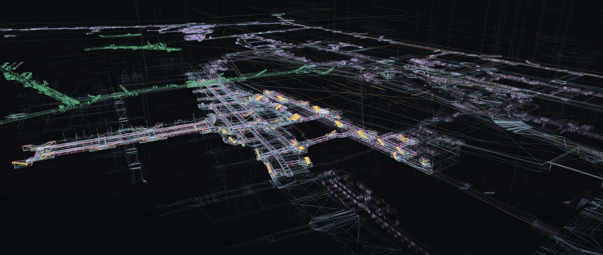
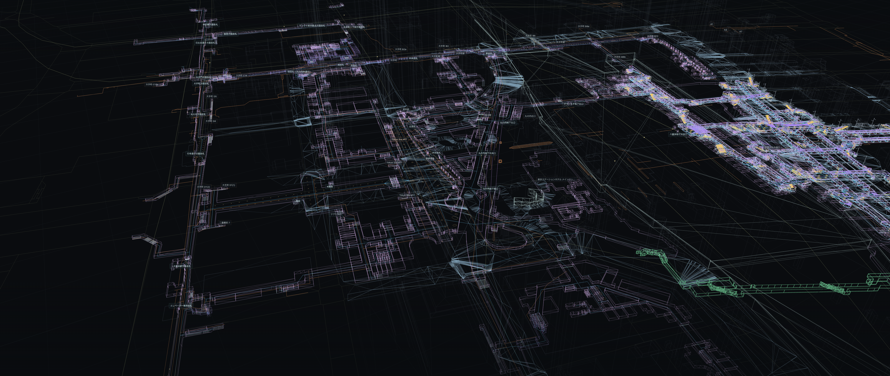
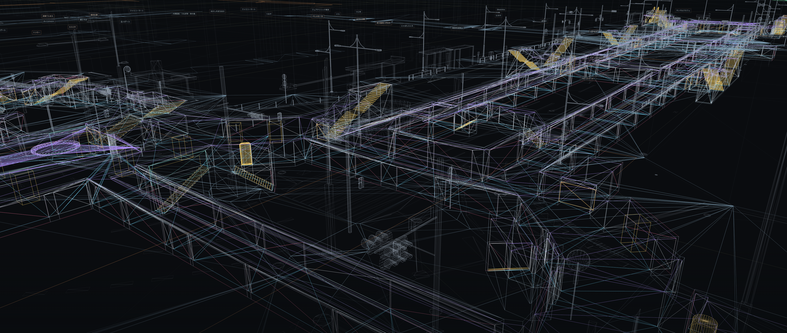

プラトーと読む。国土交通省が主導するデジタルツインプロジェクト。GML形式で公開されている。

- **GML (Geography Markup Language):** 建物、道路、河川、土地などの地理情報を表現するXML形式
- **CityGML:** 都市の3D表現が拡張されたGML。建物の形状、用途、構成要素などを含む (LOD)
- **LOD (Level of Detail):** 0〜4の5段階で数字が大きほど詳細
    - **LOD0:** 建物の平面形状
    - **LOD1:** 立体形状 (直方体)
    - **LOD2:** 屋根や壁の形状
    - **LOD3:** 窓・ドア・外壁の細部
    - **LOD4:** 部屋や廊下などの内部空間

CityGML 3.0ではデータモデルと保存形式が分離されている。GMLの再生形式としては 3D Tiles が有名。

- **3D Tiles:** 空間を格子分割し部分的に描画することで高速レンダリングする手法。メタデータを保持可能で `tileset.json` `.glb` `.b3dm` など。

より実際に近いデータとして、LiDAR由来の点群も一部公開されている。

---

おもしろそうだったので、Three.jsでビュワーをでっちあげてみた [plateau-wireframe-viewer](https://mi2428.github.io/plateau-wireframe-viewer/)。
新宿駅地下連絡通路およびその地上構造物を三次元ワイヤーフレームで描画したのがこちら。

地理空間のオープンデータは探せばいろいろ手に入ると気づいた。次は東京駅地下街とその地上構造物を複数のソースで統合してみる。

- まずはPLATEAU 2025から東京駅周辺の地上建物・道路・橋・都市設備の3D境界、鉄道路線・駅地点の平面位置を収集。
  地上構造は駅中心の約350m四方の探索範囲を基準に選択。鉄道の平面資料は中心から約1,200m以内を検索。
  さらに[B1地下通路](https://www.geospatial.jp/ckan/dataset/plateau-13101-chiyoda-ku-2025)の床・壁・天井などの3D境界を約11.8万線分、東京駅付近の約360×473mで高解像度に回収し、これを骨格データとする
- 2023年度の[UC23-05](https://www.geospatial.jp/ckan/dataset/plateau-uc23-05)から地下街3D境界を追加で約40.6万線分。主に東京駅中心より南・東側へ広がる約1.88×0.95kmの外接範囲を回収
- 2020年度の[国交省・東京駅周辺屋内図](https://www.geospatial.jp/ckan/dataset/mlit-indoor-tokyo-r2)から歩行ネットワークを3,368ノード・3,798リンク、B1/B2の区画1,708件。
  原図線、床・設備、改札・施設名を抜き出し。東京駅だけでなく、大手町・丸の内・日比谷・有楽町・銀座方向にも広がる地下平面図を回収
- 2018年度の[国交省 歩行空間ネットワーク](https://www.hokoukukan.go.jp/metadata/detail/80)から追加で4,161ノード・4,947リンク
- OpenStreetMapを使い地下・屋内歩行路の抜け漏れチェック、深い階のホーム輪郭候補4件を回収。店舗・駅名など主要ランドマークラベルを収集しマッピング

AI時代のOSINT、とても楽しいね。5ドルもかからずにこんなのが作れちゃう。PLATEAUは点群データも一部公開しているので、そっちでも遊んでみたい。

